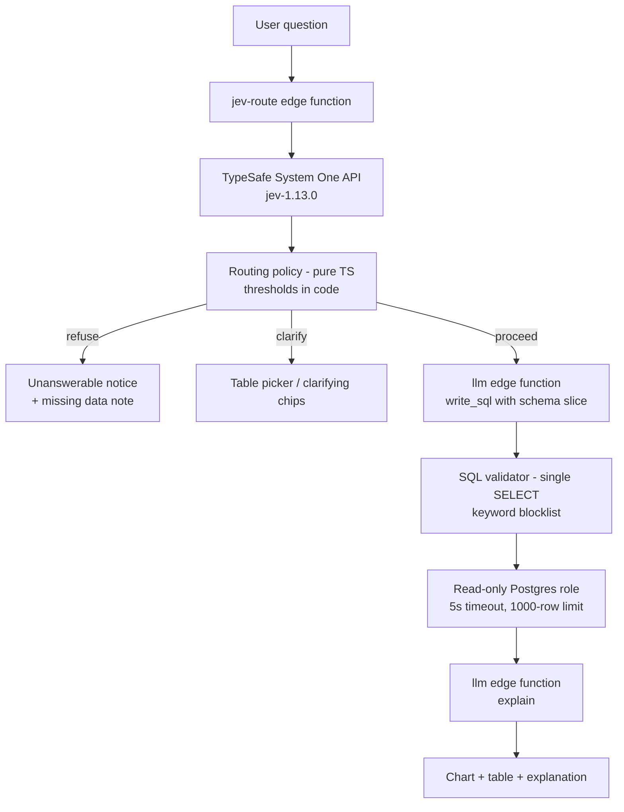

# Ask Your Data

Ask a plain-English question about your data and get SQL, a chart, and a short explanation — built as a two-system pipeline:

1. **Jev (System 1)** — TypeSafe's fast decision model. It checks whether the question is answerable from the schema at all, picks the main table, and selects the relevant columns. It is cheap, calibrated, and fast.
2. **The LLM (System 2)** — a general-purpose LLM that writes the SQL using *only* the schema slice Jev selected, then explains the results in plain English.

A TypeScript routing policy sits between them with configurable thresholds (Strict / Balanced / Loose presets). The code validates the generated SQL as read-only and executes it under a locked-down Postgres role.

## Architecture

## Why a fast calibrated router comes first

- **Refuses unanswerable questions early.** "What's the weather in Denver?" never reaches the LLM, so it never hallucinates a plausible-looking query over unrelated tables.
- **Sends smaller prompts.** The SQL-writing LLM only sees the chosen table(s) and columns — not the entire schema. Fewer input tokens, lower cost, less noise.
- **Fewer hallucinated columns.** When the model only sees columns a calibrated router flagged as relevant, it cannot invent columns that don't exist.
- **Thresholds kept in code.** Calibration decisions live in a pure TypeScript function with sliders and presets — testable, versioned, and tunable without prompt edits.

## Safety

- **Read-only Postgres role.** Generated SQL never runs as a privileged user. `run_readonly_sql` is a SECURITY DEFINER function *owned by* the `NOLOGIN` role `sql_runner`, which only has SELECT on the demo and uploaded data. It also switches the transaction to read-only and hides PostgREST's request headers/JWT claims from the query.
- **Validator.** Only a single `SELECT` or `WITH ... SELECT` statement is accepted. A small lexer rejects chained statements (`;`), write/DDL keywords (`insert`, `update`, `delete`, `merge`, `into`, `drop`, `alter`, `create`, `grant`, `truncate`, `copy`, ...), catalog/settings functions (`pg_*`, `current_setting`, `set_config`, `query_to_xml`, `lo_*`, ...), schemas other than `demo`/`uploads`, and quoting tricks (dollar quotes, `E''`/`U&` escapes, block comments).
- **Statement timeout.** The runner declares `statement_timeout = 5s` (PostgREST applies function-level timeouts to RPC calls) and arms `transaction_timeout` on Postgres 17+.
- **Row limit.** `LIMIT 1000` is appended when the user's SQL has no limit, and the runner never returns more than 1,000 rows (about 2 MB).
- **Daily call limits.** Every paid upstream request (TypeSafe, OpenAI), including retries and split batches, is counted against a per-day cap (`DAILY_CALL_LIMIT`, default 200) before it is sent; the `data` function has its own per-request cap. Past the limit the functions return 429 `{ "error": "daily_limit" }` and the UI shows a banner. If the counter can't be read, they fail closed with 503.
- **Server-side writes only.** The browser can read `questions`, `routing` and `queries` but not write them; the Edge Functions record rows with the service-role client. `usage_counters` and the `uploads` schema are not accessible to `anon`/`authenticated` at all; uploads are created only through `create_upload_table()` and read through the `data` function.
- **Authenticated functions.** All three functions run with `verify_jwt = true`; the frontend calls them with `supabase.functions.invoke`, which sends the anon key as the Bearer token.
- **Bounded requests.** Bodies over the limit get 413; questions are capped at 500 characters, CSV uploads at 5 MB / 50,000 rows / 100 columns, generated SQL at 10,000 characters. Upstream API errors are logged server-side and never returned to the client.

## Setup

1. Create a Supabase project.
2. Apply the migrations (demo data, app tables, read-only runner).
3. Set the secrets: `supabase secrets set TYPESAFE_API_KEY=... OPENAI_API_KEY=...`
4. Deploy the three edge functions: `data`, `jev-route`, `llm`.
5. Seed data is created automatically on first load.
6. `npm install && npm run dev`

## Environment variables

| Variable | Required | Description |
| --- | --- | --- |
| `VITE_SUPABASE_URL` | yes | Supabase project URL |
| `VITE_SUPABASE_ANON_KEY` | yes | Supabase anon key |
| `TYPESAFE_API_KEY` | server secret (optional) | TypeSafe API key for Jev; without it `jev-route` uses a keyword-based mock router |
| `OPENAI_API_KEY` | server secret (optional) | OpenAI key for the SQL/explain LLM; without it the `llm` function returns mock output |
| `OPENAI_BASE_URL` | server secret (optional) | Override for OpenAI-compatible endpoints |
| `OPENAI_MODEL` | server secret (optional) | Defaults to `gpt-4o-mini` |
| `DAILY_CALL_LIMIT` | server secret (optional) | Daily per-function call cap, default 200 |

`.env.example` lists only the two Vite variables.

## Screenshots

## Design decisions

- **Jev pinned to `jev-1.13.0`.** Router behavior must be stable for the policy thresholds above it to mean anything.
- **One fan-out request per question.** All routing questions (answerable, table, columns, join, ambiguous) go in a single TypeSafe call; if the payload is too big it splits into routing + column requests.
- **Thresholds in code, not prompts.** A prompt can't be unit-tested. The routing policy is a pure function, so presets and sliders are deterministic.
- **Mock LLM mode still runs Jev live.** The demo remains meaningful without an OpenAI key — routing, validation, and execution are real; only drafting/explaining are templated. Until `TYPESAFE_API_KEY` is set, Jev itself falls back to a keyword-based mock router (marked `mocked: true`) so the whole pipeline still works.
- **CSV uploads become real tables.** Parsed in the browser, typed via inference, and created under the `uploads` schema so the same read-only guard applies.
